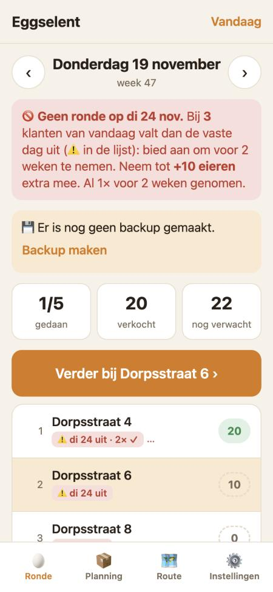
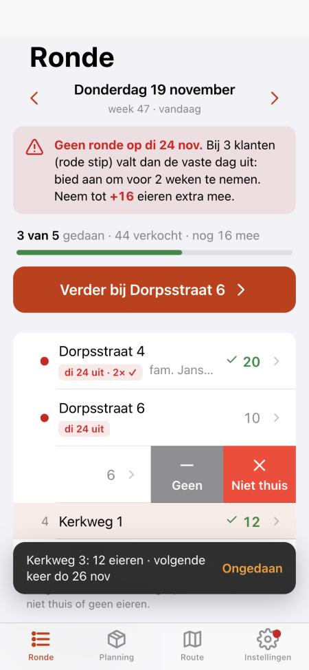
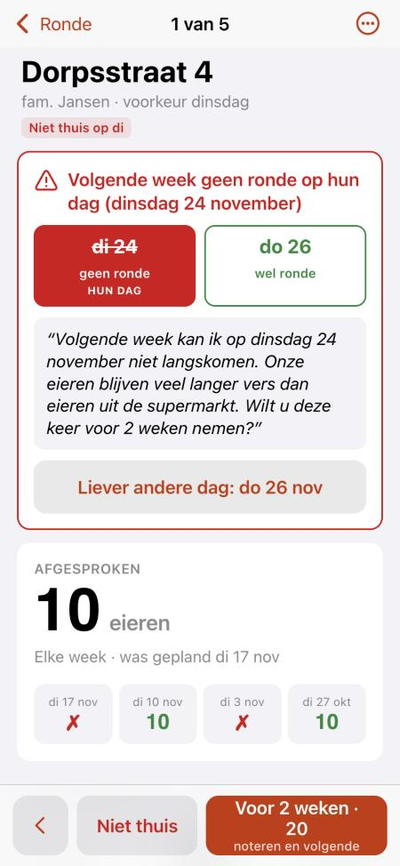
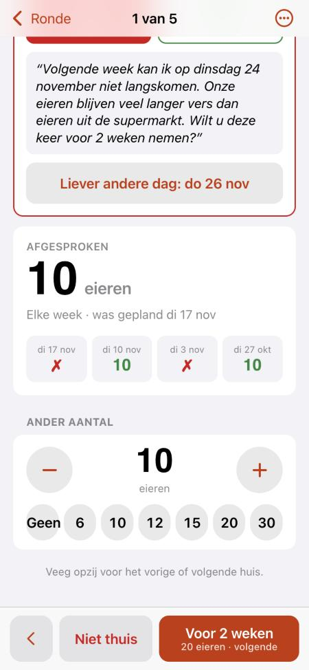
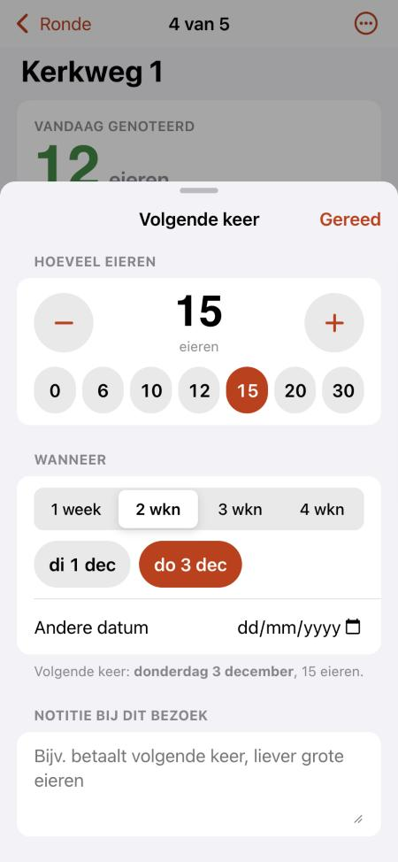
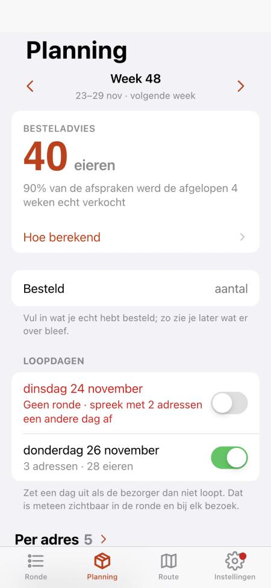
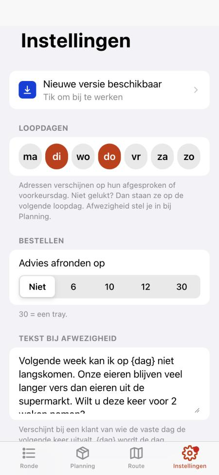
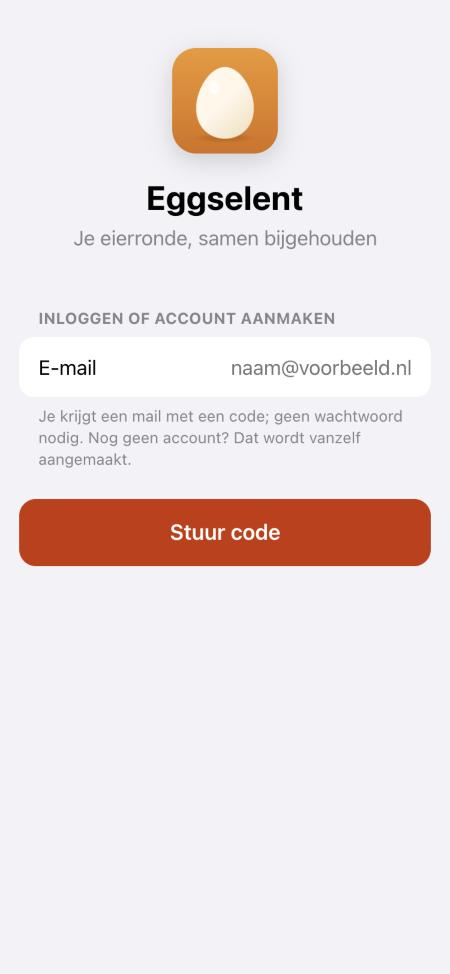
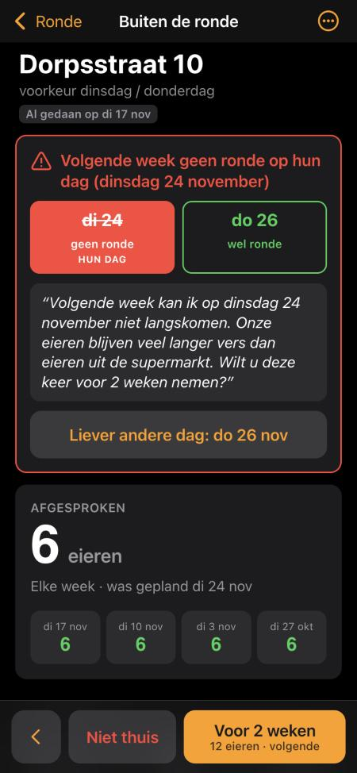
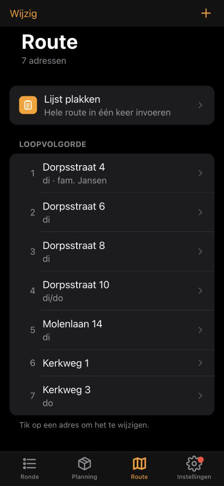

# Egg-sellent — plan

*Vers aan de deur, slim gepland.*

Een webapp voor de iPhone om een vaste eierronde te lopen: van huis naar huis, per adres
direct vastleggen hoeveel eieren er zijn afgenomen, **hoeveel en wanneer de volgende keer**,
en op basis daarvan elke week voorspellen hoeveel eieren er besteld moeten worden.
Later ook voor andere eierverkopers, met een eigen account.

---

## 1. Wat er nu staat (v2.0.0)

Een werkende **PWA** (Progressive Web App): een website die je via Safari op het
beginscherm zet en die daarna opent als een app (eigen icoon, volledig scherm, werkt offline).
Geen App Store nodig.

| Bestand | Wat |
|---|---|
| `index.html` | De hele app (schermen, logica, opslag) |
| `sw.js` | Service worker: offline werken + updates binnenhalen |
| `manifest.webmanifest` | Naam, icoon, "open als app" |
| `config.js` | Koppeling met Supabase (leeg = alleen op deze telefoon) |
| `icon-*.png` | App-iconen (te maken met `python3 tools/make_icons.py`) |
| `supabase/` | Databaseschema, mailtekst met inlogcode, installatiehandleiding |

Gegevens staan altijd eerst op de telefoon (werkt zonder bereik). Met een koppeling aan
Supabase komen daar accounts, teams en synchronisatie bij (§3).

### Functies

**Ronde** (tabblad 🥚)
- Datum (wisselen met ‹ ›), voortgang: gedaan · verkocht · **nog verwacht** (wat je nog
  mee moet nemen), knop "Start ronde / Verder bij …".
- Lijst in loopvolgorde; open adressen tonen het **afgesproken aantal**.
- Melding als de bezorger binnenkort een dag niet loopt, met hoeveel klanten van vandaag het
  raakt en hoeveel eieren je extra mee moet nemen voor wie voor 2 weken wil nemen. In de lijst
  staat bij die klanten **⚠️ di 24 uit** (en **2× ✓** als ze voor 2 weken namen).
- "Niet vandaag" (inklapbaar) met reden: al gedaan, afgesproken op een andere dag,
  volgende keer pas over 2 weken, andere voorkeursdag.

**Huis** (bij elk adres)
- Laatste 4 keer als tegels + **"Afgesproken voor nu: 10 eieren"**.
- Nu: één tik **"Zoals afgesproken: 10"**, of −/+ en snelknoppen, **Niet thuis**,
  **Geen eieren**.
- **Volgende keer, bij elk bezoek (ook bij "geen eieren")**:
  - **hoeveel eieren** (standaard: het aantal van vandaag, of de vorige afspraak);
  - **wanneer**: deze week (uitstellen) / volgende week / 2–4 weken, dan de **dag**;
    dagen waarop de bezorger afwezig is, zijn doorgestreept;
  - samenvatting om aan de deur voor te lezen:
    *"di 24 nov geen ronde → donderdag 26 november · 10 eieren"*.
- **Vaste dag valt de volgende keer uit** (bezorger afwezig): bovenaan het huis een rode kaart
  met (zie §1.3):
  - een **weekstrook** van die week: *di 24 ~~geen ronde~~ · HUN DAG* naast *do 26 wel ronde*;
  - de **tekst om te vertellen**: *"Volgende week kan ik op dinsdag 24 november niet
    langskomen. Onze eieren blijven veel langer vers dan eieren uit de supermarkt. Wilt u
    deze keer voor 2 weken nemen?"* (aan te passen bij Instellingen);
  - twee knoppen: **"Voor 2 weken: 20 eieren nu"** (volgende keer over 2 weken, gewone
    hoeveelheid) of **"Liever andere dag: do 26 nov"**.
- Alles wordt bij elke tik direct opgeslagen. Vorige/Volgende onderaan.

**Planning** (tabblad 📦)
- **Besteladvies per week**, standaard voor volgende week (zie §1.2).
- Invoer **"Besteld voor week 48"**: wat de verkoper echt besteld heeft.
- **Per loopdag** het verwachte aantal eieren en adressen, met een knop **"Afwezig?"**.
  Staat een afwezige dag nog vol, dan waarschuwt de app:
  *"Geen ronde: spreek met deze 2 adressen deze week een andere dag af."*
- Per adres-overzicht en historie: week · besteld · verkocht · verschil.

**Route** · **Instellingen**
- Volgorde (▲▼ of "plek in de route"), adres toevoegen, hele route **plakken**
  (`Dorpsstraat 12`, `14`, `Kerkweg 1-15 oneven`, `20-2 even`).
- **Meerdere of geen voorkeursdagen** per adres.
- Uitsluiten / weer opnemen. Loopdagen, afronding van het advies (bijv. op 30 = tray),
  backup, CSV-export.

### 1.1 Regels voor de route van de dag
1. **Afgesproken dag gaat voor.** Valt de afspraak in deze week, dan komt het adres op die
   dag (en als het dan niet lukt, op de volgende loopdagen als "inhalen").
2. **Anders de voorkeursdag(en).** Meerdere voorkeursdagen: het adres verschijnt op de eerste
   en schuift door naar de volgende als het niet lukte. Geen voorkeur: elke loopdag.
3. **Wie deze week al gekocht, geweigerd of uitgesteld heeft, valt eruit.**
   Uitzondering: "kom donderdag maar terug" (afspraak later in dezelfde week). Dan staat het
   adres donderdag gewoon weer in de route.
4. **Niet thuis** verandert de afspraak niet; het adres staat op de volgende loopdag
   gemarkeerd met "Niet thuis op di".
5. **Afwezigheid**: wie op een afwezige dag stond, schuift door naar de volgende loopdag
   ("Inhalen (afwezig)"). Nieuwe afspraken slaan afwezige dagen automatisch over.

### 1.2 Voorspelling en besteladvies
Per adres, voor de gekozen week:

| Soort | Wat telt mee |
|---|---|
| **Verkocht** | Al bezocht in die week: het echte aantal |
| **Afgesproken** | Laatste afspraak valt in die week: het afgesproken aantal |
| **Vast ritme** | Afspraak ligt eerder (adres deze week nog niet bezocht): het ritme (elke week, om de 2 weken, …) wordt doorgetrokken |
| *Nieuw / lang niet bezocht* | Telt **niet** mee, wordt alleen als aantal getoond |

**Advies = verkocht + (afgesproken + vast ritme) × realisatie**, afgerond op de ingestelde
eenheid.
- **Realisatie** = hoeveel procent van de afspraken de afgelopen 8 weken echt is verkocht
  (begrensd tussen 50% en 110%; bij minder dan 3 weken historie: 100%).
- Bewust **conservatief**: losse verkoop buiten afspraken om en nieuwe adressen staan er
  als informatie bij, maar tellen niet mee. Liever een paar te weinig dan veel over.
- Is er van de vorige week een bestelling ingevoerd, dan toont de app het **restant**
  (besteld − verkocht) en het advies min restant.

Hoe beter er bij elk bezoek een aantal + datum voor de volgende keer wordt vastgelegd, hoe
nauwkeuriger het advies.

### 1.3 Afwezigheid en "voor 2 weken"
- Een klant wordt geraakt als bij het **volgende bezoek** (volgens het eigen ritme) de
  **eerste voorkeursdag** op een afwezige dag valt.
- Aan de deur: voor 2 weken nemen (2× de afgesproken hoeveelheid nu, volgende bezoek één
  ritme overslaan) of een andere dag in die week. Kiest de klant niets, dan schuift de app
  de afspraak automatisch naar de eerste loopdag waarop wél gelopen wordt.
- **Voorspelling**: in de Planning staat bij de week vóór een afwezigheid hoeveel klanten
  voor 2 weken kunnen nemen en hoeveel eieren dat extra is. De app onthoudt bij elk bezoek of
  het aanbod is gedaan en of het is aangenomen. Na 5 keer aanbieden rekent het advies met het
  **echte percentage** dat ingaat op het aanbod; daarvoor toont het de bandbreedte (niemand
  … iedereen). Wie voor 2 weken nam, telt de week erop niet mee en vervalst de
  realisatie niet.

---

## 2. Design (v2.1, iOS-stijl)

Na een UX-review (Apple Human Interface Guidelines) is de app herontworpen zodat hij aanvoelt
als een echte iPhone-app: rijk aan mogelijkheden, maar met één duidelijke handeling per moment.

**Aan de deur (huisscherm)**
- Onderaan, onder de duim: **"Zoals afgesproken"** noteert in één tik en gaat door naar het
  volgende huis, met "Ongedaan" in de melding. Ernaast **Niet thuis** (ook noteren en door).
- Valt de dag van de klant volgende week uit: rode kaart met weekstrook en tekst, en de
  hoofdknop wordt **"Voor 2 weken"**.
- Het **afgesproken aantal staat groot** bovenaan, met de laatste 4 keer als strook.
- "Ander aantal": stepper + snelknoppen (Geen, 6, 10, 12, 15, 20, 30).
- **Volgende keer en notitie** zijn één regel die een paneel van onderen opent (zoals in
  Herinneringen): aantal, weken (segmentknop), dag, andere datum.
- Opzij vegen = vorig/volgend huis. Menu (…) voor adres wijzigen, invoer wissen, uitsluiten.

**Ronde**: grote titel, één melding tegelijk, voortgangsbalk ("3 van 5 · 44 verkocht · nog 16
mee"), lijst zoals in Instellingen. **Vegen zoals in Mail**: naar rechts = zoals afgesproken,
naar links = Geen / Niet thuis. Rode stip = aandacht nodig.

**Overal**: iOS-systeemkleuren (toegankelijke varianten, leesbaar in de zon), automatisch donker
thema, SF-lettertype dat meeschaalt met de tekstgrootte van de iPhone, eigen iconen in de stijl
van SF Symbols, wazige navigatie- en tabbalk, schuifovergangen tussen schermen, iOS-actiebladen
in plaats van pop-ups, schakelaars voor loopdagen, tikvlakken van minimaal 44 punten.
Updates worden stil geïnstalleerd zodra de app naar de achtergrond gaat.

| Ronde | Vegen | Huis: dag valt uit | Huis: afspraak |
|---|---|---|---|
|  |  |  |  |

| Volgende keer | Planning | Instellingen | Inloggen |
|---|---|---|---|
|  |  |  |  |

| Donker: huis | Donker: route |
|---|---|
|  |  |

## 3. Fase 2: accounts, teams en synchronisatie (gebouwd, v2.0.0)

De app werkt nu op twee manieren:
- **Zonder koppeling** (`config.js` leeg): zoals het prototype, alles alleen op de telefoon.
- **Gekoppeld aan Supabase**: inloggen verplicht, teams, alle telefoons van een team zien
  dezelfde gegevens. Installatie: zie [`supabase/README.md`](supabase/README.md).

### Inloggen en registreren
- **E-mail + 6-cijferige code** (geen wachtwoord). Een inlog*link* werkt niet goed op de
  iPhone: die opent in Safari en niet in de app op het beginscherm. Een code typ je gewoon in
  de app, en iOS stelt de code uit Mail zelf voor.
- Nog geen account? Dat wordt bij de eerste code vanzelf aangemaakt (registratie).
- Daarna: **Nieuw eierbedrijf** (je wordt beheerder; wat al op de telefoon stond gaat mee)
  of **Ik heb een uitnodigingscode** (je wordt bezorger).
- **Team** (Instellingen → Team): leden zien, uitnodigingscode maken en delen (14 dagen
  geldig; een nieuwe code maakt de vorige ongeldig), leden verwijderen.
- **Rollen**: beheerder = alles; bezorger = ronde lopen, adressen, afwezigheid, bestellingen.
  Loopdagen, afronding, de afwezigheidstekst en backup terugzetten (dat overschrijft het hele
  team) doet alleen de beheerder.

### Datamodel ([`supabase/schema.sql`](supabase/schema.sql))
```
teams          id, name, walk_days[], order_round, absence_script, settings_updated_at
team_members   team_id, user_id, role (admin | walker), name
team_invites   code, team_id, role, expires_at
addresses      team_id, id, street, number, name, note, pref_days[], sort, excluded
visits         team_id, id (= adres_datum), address_id, date, status, eggs,
               next_date, next_eggs, next_manual, note, double, offered
absences       team_id, date, note
orders         team_id, week_start, amount
+ op elke gegevensrij: updated_at, updated_by, deleted, server_ts
```
- Elk team ziet **alleen zijn eigen** gegevens: afgedwongen in de database (row level
  security), niet alleen in de app. Getest: een gebruiker buiten het team ziet 0 rijen en kan
  niets toevoegen.
- Een bezoek heeft als sleutel **adres + datum**: twee telefoons die hetzelfde huis op
  dezelfde dag invullen, schrijven naar dezelfde rij.

### Offline eerst
1. Elke tik wordt eerst lokaal opgeslagen en wat er veranderd is, gaat in een **wachtrij**.
2. Met internet: wachtrij versturen, daarna ophalen wat teamgenoten wijzigden. Dat gebeurt
   bij openen, bij terugkomen in de app, na elke wijziging, als het internet terugkomt, en
   elke minuut.
3. **Laatste wijziging wint**, ook op de server afgedwongen: een telefoon die lang offline
   was, overschrijft geen nieuwere invoer. "Laatste" gaat op de klok van de telefoon; iPhones zetten hun
   tijd automatisch gelijk, dus het verschil is hooguit seconden.
4. Verwijderen gaat via een "verwijderd"-markering en komt zo op alle telefoons door.
5. Status rechtsboven: ✓ · ⟳ 3 · offline · ⚠️. Een verlopen sessie logt nooit uit zonder
   te vragen; gegevens en wachtrij blijven bewaard.

### Getest tegen een lokale Supabase (Docker)
Met twee "telefoons" (aparte browseropslag) en echte login-mails:
- prototype-gegevens (7 adressen, 23 bezoeken, afwezigheden, bestelling) gaan mee bij
  "Nieuw eierbedrijf";
- tweede gebruiker wordt lid met een code en krijgt alles binnen, in dezelfde volgorde;
- offline invoer komt na herstel van de verbinding op de andere telefoon;
- conflict op hetzelfde huis/dezelfde dag: één rij, de nieuwste wint, ook als de oudere
  later binnenkomt;
- wissen, afwezigheid melden en adresvolgorde komen over; verlopen sessie wordt ververst;
- bezorger kan loopdagen niet wijzigen.

**Niet lokaal te testen**: echte mailbezorging via je eigen SMTP, iOS die de code uit Mail
voorstelt, installeren op het beginscherm.

### Fasering
1. **Fase 1 – prototype** ✓
2. **Fase 2 – accounts en sync** ✓ (in te richten volgens `supabase/README.md`)
3. **Fase 3 – extra's** (als er behoefte is): afwezigheid per bezorger (zie open vragen),
   prijs per ei / omzet, betaald/openstaand, kaartweergave, meerdere routes per team,
   melding "bestel vóór …", oude bezoeken (> 1 jaar) niet meer op de telefoon bewaren.

## 4. Op de telefoon zetten en updaten

1. Zet `index.html`, `sw.js`, `manifest.webmanifest`, `config.js` en `icon-*.png` op een **https**-adres (vereist voor offline/updates), bijvoorbeeld
   `https://eieren.jouwdomein.nl/` of GitHub Pages.
2. Open dat adres op de iPhone in **Safari** → deel-knop → **"Zet op beginscherm"**.
3. Gebruik daarna **alleen het icoon** op het beginscherm. Let op: op iOS heeft de
   beginscherm-app een eigen opslag, los van Safari.

**Updaten**: nieuwe bestanden uploaden en in `sw.js` én `index.html` het versienummer ophogen.
De app haalt de nieuwe versie zelf op en toont "Nieuwe versie beschikbaar — tik om te vernieuwen".
De gegevens blijven bewaard, **zolang het adres (domein + map) hetzelfde blijft**. Ga je
verhuizen naar een ander adres, maak dan eerst een backup. Gegevens uit een oudere versie
worden bij het openen automatisch omgezet.

Lokaal testen: `python3 -m http.server 8765` in deze map en open `http://localhost:8765`.
Op de iPhone (zelfde wifi) via `http://<ip-van-de-mac>:8765`. Zonder https werken offline
en installeren daar niet, maar alle schermen wel.

---

## 5. Besluiten

**18 nov 2026**
- Backend: **Supabase**. Inloggen met **e-mail + code** (geen link: die opent op de iPhone in
  Safari in plaats van in de app).
- Gebruikers: **beide**: losse verkopers met elk een eigen route (team), én meerdere
  mensen/telefoons per team op dezelfde route.
- Bij **elk bezoek** (ook "geen eieren") wordt vastgelegd: hoeveel de volgende keer en wanneer.
- De **voorspelling / het besteladvies** per week is een kernfunctie; conservatief rekenen.
- **Afwezigheid van de bezorger** is per dag op te geven en zichtbaar in de ronde en bij elk
  bezoek; afspraken schuiven naar een andere loopdag.
- Adressen kunnen **meerdere of geen voorkeursdagen** hebben.
- Valt de vaste dag van een klant de volgende keer uit, dan staat dat **groot in beeld** met
  een tekst om te vertellen (langer houdbaar dan supermarkteieren) en de optie **voor 2 weken**.
  Dat telt mee in de voorspelling.

### Schaal
- Eén bezoek is ±200 bytes. 200 adressen × 52 weken ≈ 10.000 bezoeken ≈ **2–5 MB per
  verkoper per jaar** (incl. indexen). De gratis 500 MB is dus genoeg voor tientallen
  verkopers, meerdere jaren lang.
- Gebruikers: gratis tot 50.000 actieve gebruikers per maand. Daar komen we niet in de buurt.
- **Let op bij gratis**: (1) een gratis project wordt **gepauzeerd na 7 dagen zonder
  activiteit** (bij een wekelijkse ronde krap; in een vakantieweek moet je hem dan in het
  dashboard weer aanzetten. Pro, ±$25/mnd, heeft dit niet). (2) Supabase's eigen mailserver
  is alleen voor testen en verstuurt maar een paar mails per uur. Voor echte registraties is
  een **eigen SMTP** nodig (je eigen mailserver, of bijv. Resend/Postmark, vaak gratis bij
  dit volume). (3) Geen automatische dagelijkse backups. De backup-knop in de app blijft daarom.
- Prijzen zoals bekend bij het schrijven; controleer ze op supabase.com/pricing.

### Eigen domein
- **De app** kan gewoon op je eigen domein, bijv. `https://eieren.jouwdomein.nl`: op je
  eigen server, of via Netlify/GitHub Pages met een CNAME-record. Dat is gratis.
- **De Supabase-API** draait op `xxxx.supabase.co`. Dat ziet de gebruiker niet. Een eigen
  API-domein kan alleen op een betaald plan (add-on, ±$10/mnd), en is niet nodig.
- **Mails** (inlogcode) kunnen via eigen SMTP vanaf je eigen domein komen,
  bijv. `noreply@jouwdomein.nl`.

### Nog open
- Moet er een prijs per ei / omzet / betaald-status bij?
- Op welk (sub)domein komt de app, en welke SMTP gebruiken we?
- Afwezigheid per team (nu) of per bezorger (fase 2): als één bezorger afwezig is maar een
  ander loopt wel, gaat de ronde dan door?
